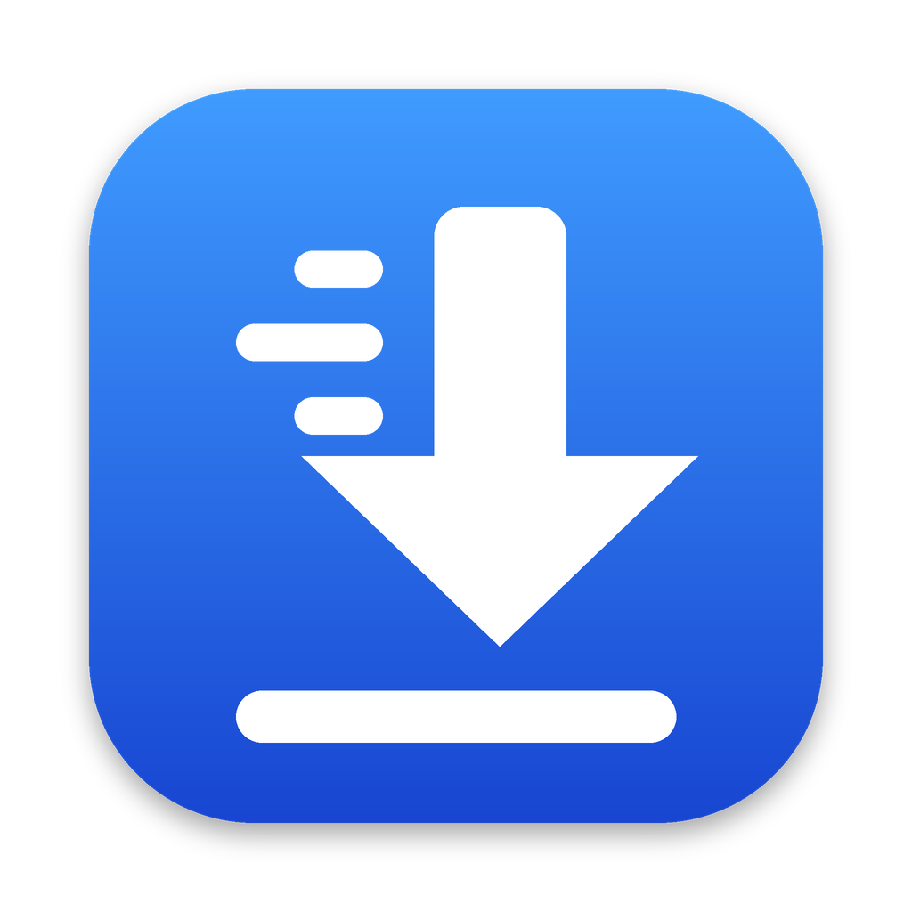

<div align="center">



# ODM

**Open Source Download Manager for macOS**

Fast multi-connection downloads, a Chrome extension and one-click video downloads — free and open source.

[](https://github.com/niruvai/odm/releases/latest)
[](https://github.com/niruvai/odm/releases)
[](https://github.com/niruvai/odm/actions/workflows/release.yml)
[](#requirements)
[](LICENSE)

[**Download**](https://github.com/niruvai/odm/releases/latest) ·
[Features](#features) ·
[Install](#installation) ·
[Usage](#usage) ·
[FAQ](#troubleshooting) ·
[বাংলায় পড়ুন](README.bn.md)

</div>

---

## Why ODM?

Windows users have IDM. On macOS, browsers download each file over a single connection, and a dropped network often means starting over. **ODM** splits every file into parts, downloads them in parallel, and picks up exactly where it stopped — with a native SwiftUI interface that feels at home on the Mac.

## Features

| | Feature | Details |
|---|---|---|
| ⚡ | **Multi-connection downloads** | 8 parallel connections per file by default (adjustable 1–32) |
| 🧩 | **Dynamic segmentation** | When a connection finishes early it takes over half of the largest remaining part, so speed holds to the end |
| ⏯️ | **Pause & resume** | Continues after network drops and app restarts; failed parts retry automatically |
| 🪟 | **Progress window** | IDM-style window per download: speed, time left and the progress of every connection |
| 🌐 | **Browser integration** | Chrome, Edge and Brave downloads go to ODM automatically, with cookies and referrer |
| 🎬 | **Video downloads** | ODM button on video pages, with a quality menu up to 1080p or audio only |
| 🗂️ | **Smart folders** | Sorted into Video, Music, Compressed, Programs, Documents and Images |
| 🔄 | **Automatic updates** | New versions install from inside the app in one click |
| 💤 | **Mac-friendly** | Menu-bar icon, Dock badge, and your Mac stays awake while downloading |

## Requirements

- macOS 13 Ventura or later
- Apple Silicon or Intel Mac (universal app)
- About 150 MB of free space for the video download components, installed once on first launch

## Installation

1. Download **[ODM.dmg](https://github.com/niruvai/odm/releases/latest)** from the latest release.
2. Open it and drag **ODM** onto the **Applications** folder in the window.
3. Open ODM. Because ODM is not notarized by Apple, macOS may block the first launch: open **System Settings → Privacy & Security**, scroll down and click **Open Anyway**.

On first launch, ODM shows a **setup screen** while it installs the components needed for video downloads, with the progress of each one. When it finishes, a **step-by-step guide** helps you connect the Chrome extension.

### Chrome extension

The guide walks you through it, and you can reopen it any time from **Settings → Browser → Open Setup Guide…**

1. Open `chrome://extensions` in Chrome (Edge and Brave work the same way).
2. Turn on **Developer mode** in the top-right corner.
3. Click **Load unpacked** and choose `~/Library/Application Support/ODM/ChromeExtension` — or drag that folder onto the extensions page.

The guide turns green when the extension is connected. After an ODM update, click **↻ Reload** on the ODM extension in `chrome://extensions`.

> **Tip:** In Chrome's **Settings → Downloads**, turn off *“Ask where to save each file before downloading”*.

## Usage

| Task | How |
|---|---|
| Add a download | Press **⌘N** — a copied link is filled in automatically; paste several links, one per line |
| Download from Chrome | Download as usual; ODM takes over |
| Download a video | Click **ODM** under the video, or **Download** on the player, and pick a quality |
| Other video sites | ODM extension icon → **Download video**, or right-click the page → **Download video with ODM** |
| Pause / resume | Toolbar buttons, right-click, or the progress window |
| Pause all / resume all | **⇧⌘P** / **⇧⌘R** |
| Open a finished file | Double-click it, or **Open Folder** in its progress window |
| Settings | **⌘,** |

Files are saved to `~/Downloads/ODM/<category>/`. The download folder, number of connections, parallel downloads and default video quality can be changed in Settings.

> **Please download responsibly.** Only download videos you have the right to save — your own uploads, Creative Commons content, or with the owner's permission — and respect each site's terms of service.

## Updates

ODM checks for a new version at launch and every 6 hours. When one is available, a banner appears at the top of the window — click **Update Now** and ODM installs it and restarts; unfinished downloads continue where they left off. You can also check manually from **ODM → Check for Updates…**

## Troubleshooting

<details>
<summary><b>The setup screen stops or shows an error</b></summary>

Check your internet connection and click **Try Again**. The components are downloaded from GitHub and the FFmpeg build server; a firewall or VPN that blocks them will stop the setup.
</details>

<details>
<summary><b>A video says “Sign in to confirm you're not a bot” or “HTTP 403”</b></summary>

Turn on **Settings → Video → Use my browser sign-in**, then send the video again with the ODM button on the page. The extension passes your sign-in to ODM.
</details>

<details>
<summary><b>There is no ODM button on YouTube</b></summary>

Refresh the page (**⌘R**). If it still doesn't appear, check that the extension is enabled in `chrome://extensions`.
</details>

<details>
<summary><b>The extension says “ODM app is not running”</b></summary>

Open ODM. It keeps running in the menu bar when you close its window.
</details>

<details>
<summary><b>Known limitations</b></summary>

- Servers that don't support byte ranges download over one connection and can't be resumed.
- Some downloads started from a POST form can't be handed to ODM.
- Private and members-only videos can't be downloaded.
- ODM runs on macOS only.
</details>

## Privacy

ODM has no accounts, analytics or tracking. The browser extension talks only to the ODM app on your own Mac (`127.0.0.1`). Website sign-in cookies used for video downloads are stored locally in a private file that only your user account can read. ODM connects to the internet only to download your files, to install and update its video components, and to check GitHub for app updates.

## Building from source

Requires Apple's Command Line Tools (`xcode-select --install`); full Xcode is not needed.

```bash
git clone https://github.com/niruvai/odm.git
cd odm
./build.sh --install    # builds ODM.app and installs it to /Applications
```

Every push to `main` is built by [GitHub Actions](.github/workflows/release.yml) as a universal app and published as a release; the in-app updater installs releases from there.

<details>
<summary><b>Project structure</b></summary>

```
Sources/ODM/
  ODMApp.swift            app entry, menus, local bridge startup
  DownloadEngine.swift    multi-connection engine, dynamic segmentation, retries
  Prober.swift            file size, name and range-support detection
  DownloadManager.swift   download list, queue, persistence, notifications
  YtDlp.swift             video components setup and the video download runner
  VideoPrefetch.swift     fetches video info early so downloads start faster
  ProgressWindow.swift    per-download progress window
  SetupView.swift         first-launch setup screen
  ChromeGuide.swift       Chrome extension setup guide
  Updater.swift           in-app updates from GitHub Releases
  LocalServer.swift       127.0.0.1:9614 bridge for the browser extension
  ContentView.swift       main window
  OtherViews.swift        add dialog, detail panel, settings, menu bar
  Author.swift            About window and credits
  Models.swift            data model
  Support.swift           preferences and helpers
  UIState.swift           window state (no @State, so it builds without Xcode)
ChromeExtension/          browser extension (Manifest V3)
build.sh                  builds, signs and installs ODM.app
```
</details>

## Contributing

Bug reports and ideas are welcome in [Issues](https://github.com/niruvai/odm/issues). For security problems, please follow the [security policy](SECURITY.md) instead of opening a public issue.

## Acknowledgements

Video downloads are powered by [yt-dlp](https://github.com/yt-dlp/yt-dlp) (Unlicense), [Deno](https://deno.com) (MIT) and [FFmpeg](https://ffmpeg.org) (LGPL/GPL). ODM downloads them separately on first launch; each keeps its own license.

## Author

**ODM is made by [Nirob Islam](https://www.nirobislam.com/en/).**

[Website](https://www.nirobislam.com/en/) · [Facebook](https://www.facebook.com/mdnurunnabiislamniroob) · [Instagram](https://www.instagram.com/niru_bhai_0/)

## License

Released under the [MIT License](LICENSE) — © 2026 Nirob Islam. If you share, fork or build on ODM, keep the copyright notice and author credit.
